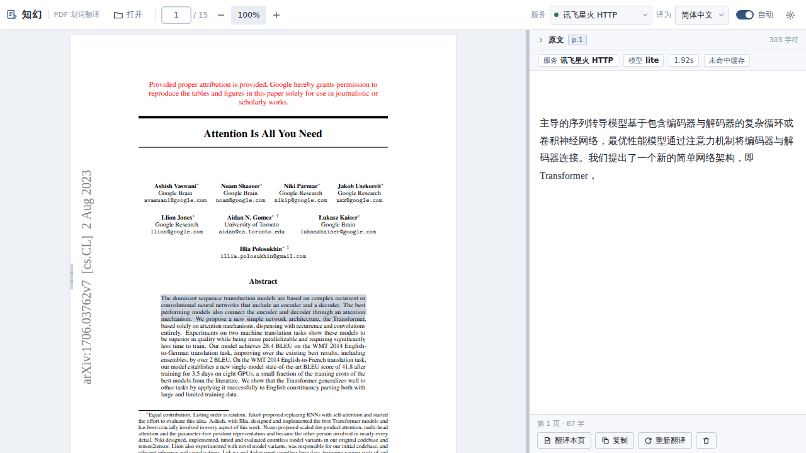

# 知幻 · PDF 划词翻译

左边读 PDF，鼠标选中就翻译，右边出译文。可同时接入多家翻译服务，密钥只存在本机。



## 快速开始

```bash
cd zhihuan
./start.sh          # 首次运行会自动建虚拟环境并装依赖
```

浏览器会自动打开 `http://127.0.0.1:8765`。拖入一个 PDF 即可。

首次打开默认使用「讯飞星火 HTTP (Lite)」。其余服务商（小牛、火山）的密钥已预填，顶栏可随时切换；想换成自己的账号就进设置重新填。

## Windows 上运行

1. 装 [Python 3.10+](https://www.python.org/downloads/)，安装时勾选 **Add python.exe to PATH**。
2. 双击 **`start.bat`**。
3. 首次会自动建环境、装依赖（约 20MB，一两分钟），之后每次双击直接启动并打开浏览器。

不需要 Node/npm，PDF.js 已随包附带；也不用开命令行，双击即可。启动后黑窗口别关，关掉就等于退出程序。

如果把整个文件夹从 Linux 拷到 Windows，`start.bat` 会发现 `.venv` 是 Linux 的，自动改用 `.venv-win`，不会冲突。

不想装 Python 的话，可以再打包成单文件 `知幻.exe`（需要额外做一次构建，见下）。

### 打包成 exe（可选）

在 Windows 上装好 Python 后，项目根目录执行一次：

```bat
start.bat --build
```

会生成 `dist\Zhihuan\Zhihuan.exe`，之后不再需要 Python，直接把 `dist\Zhihuan` 整个文件夹拷走即可（首次运行会在旁边生成 `data\` 存配置和缓存）。


## 支持的翻译服务

| 服务 | 需要 | 说明 |
|---|---|---|
| 硅基流动 SiliconFlow | API Key | 聚合平台，混元 MT 翻译模型约 0.6s；Qwen 系有免费额度 |
| B站 Index-Translate | 无需密钥 | 哔哩哔哩开源翻译模型公共 API，完全免费；2B/9B/35B 三档可选 |
| 智谱 GLM | API Key | OpenAI 兼容，`glm-4-flash` 有免费额度 |
| 讯飞星辰 MaaS | APIKey | OpenAI 兼容，模型 ID 见控制台模型广场 |
| 小牛翻译 | API Key（可选 AppId） | 有 AppId 走新版 v2 签名接口，否则走旧版 |
| 火山翻译 | AccessKey + SecretKey | 需先在控制台开通机器翻译 |
| 讯飞星火 HTTP | APIKey + APISecret | `spark-api-open.xf-yun.com`，无需 APPID，Lite 免费 |
| 讯飞星火（WebSocket） | APPID + APIKey + APISecret | 控制台三件套齐全时可用，流式 |
| 百度翻译 | APP ID + 密钥 | `fanyi-api.baidu.com`，免费版 1 QPS，超长自动按句切块 |
| 自定义 OpenAI 兼容 | Base URL + Key + 模型 | DeepSeek、Kimi、硅基流动、OneAPI、本地 Ollama / vLLM |

多个服务可以同时填好密钥，顶栏随时切换，不用重复输入。

## 功能

- 连续滚动阅读，长文档按需渲染（不会一次画几百页）
- 划词即译，流式输出；支持整页翻译
- **划词高亮 + 备忘录**：4 种荧光笔颜色，可给任意高亮写笔记，右侧「笔记」tab 汇总全文标注
- **Ctrl+S 保存回 PDF**：把高亮/便签写成真实的 PDF 注释（`/Highlight`、`/Text`），Acrobat、Edge、macOS 预览都能看到
- PDF 断行、断词连字符自动合并（`inter-\nnational` → `international`），中文之间不会留空格
- 翻译结果本地缓存（SQLite），同一句不重复计费
- 设置页每家服务可单独「测试连接」，直接看到耗时和返回样例
- 面板宽度、缩放、自动翻译开关会记住

## 密钥与隐私

- 配置保存在 `data/config.json`，文件权限 `600`，只在本机。
- 翻译时文本会发给你选中的那家服务商，不经过任何第三方服务器。
- 本程序没有账号体系，也不联网上报任何数据。

## 标注与备忘录

划选文字后，选区旁会出现小工具条：4 个颜色圆点 = 直接高亮，「笔记」= 高亮并写备忘录。点击已有高亮可以改色、改笔记或删除。

- **自动存本地**：标注实时写进浏览器 IndexedDB，关掉再打开同一个 PDF 会自动恢复（即使你从不按 Ctrl+S）。
- **Ctrl+S 保存**：
  - Chrome / Edge：通过文件句柄**直接覆盖原 PDF**（第一次打开文件时浏览器会请求一次写入授权）。
  - Firefox / 其他浏览器：浏览器不允许网页写磁盘，Ctrl+S 会导出 `原名-标注.pdf` 副本。
  - 拖拽进来的文件没有写入句柄，也走导出。
- 写回时会保留 PDF 原有内容与链接，注释是可编辑的真实注释（不是图片），不会破坏原文。
- 保存始终基于「打开时的原始字节」重建，**反复保存不会让高亮叠加**；删掉标注再保存，文件里也会一并清除。

## 一些坑

**扫描件翻不了。** PDF 里必须有文字层（能在网页上选中文字）。纯图片扫描的 PDF 需要先 OCR（比如 `ocrmypdf`），本项目不含 OCR。

**返回 401 / 100009 InvalidAccessKey。** 密钥不对，或火山账号没开通机器翻译服务。火山需要在「机器翻译」控制台开通后再用。

**企业代理。** 本程序直连各服务商，不读取系统代理环境变量。如果你在内网必须走代理，需要在 `backend/adapters/*.py` 里把 `trust_env=False` 改成 `True`。

**长文本超出限制。** 单次请求文本上限 20000 字符，划词场景足够；整页翻译会自动拼成一段。

## 目录结构

> 前端依赖（PDF.js / pdf-lib）已全部内置在 `static/vendor/`，运行时不需要 `node_modules`。
> `package.json` 仅记录版本，想重新下载依赖时执行 `npm i` 即可。

```
zhihuan/
├── start.sh               # 启动脚本
├── run.py                 # 起服务 + 开浏览器
├── requirements.txt
├── backend/
│   ├── main.py            # HTTP 接口
│   ├── config.py          # 设置与厂商字段定义
│   ├── cache.py           # SQLite 翻译缓存
│   ├── textprep.py        # PDF 文本清洗
│   └── adapters/          # 每家一个适配器
│       ├── base.py        # BaseAdapter / 翻译提示词
│       ├── openai_compat.py
│       ├── niutrans.py
│       ├── volc.py
│       ├── spark.py
│       └── mock.py
├── data/                  # config.json / cache.db（运行时生成）
└── static/                # 前端 + 本地化 PDF.js
```

## 加一家新服务

1. 在 `backend/adapters/` 新建文件，继承 `BaseAdapter`，实现 `async def translate(self, text, src, tgt) -> str`（想流式再实现 `stream`）。
2. 在 `backend/adapters/__init__.py` 的 `REGISTRY` 里注册。
3. 在 `backend/config.py` 的 `PROVIDERS` 里加一条字段定义，设置页会自动出现这张卡片。
